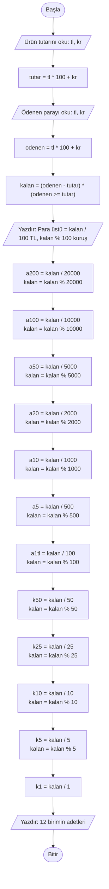

# Para Üstü Hesaplayıcı 💸

## 1. Programın Amacı

Bu program bir kasada para üstü verirken kullanılabilecek basit bir hesaplayıcı. Ürünün tutarını ve müşterinin ödediği parayı alıyor, para üstünü hesaplıyor ve **hangi banknottan veya bozuk paradan kaç adet verilmesi gerektiğini** ekrana yazıyor.

Ödevin kuralı şuydu: **döngü yok, `if/else` yok, dizi yok.** Program yalnızca `int` değişkenler ve operatörlerle (`+`, `-`, `*`, `/`, `%`, `>=`) çalışıyor.

- **Girdi:** Ürün tutarı ve ödenen para (`TL kuruş` şeklinde, boşlukla ayrılmış)
- **Çıktı:** Para üstü miktarı ve 12 farklı birimin (200 TL'den 1 kuruşa kadar) adetleri
- **Kullanılan birimler:** 200, 100, 50, 20, 10, 5, 1 TL ve 50, 25, 10, 5, 1 kuruş

## 2. Geliştirme Sürecinde Kullanılan Araçlar

| Araç | Ne için kullandım? | Nasıl yararlandım? |
|------|--------------------|--------------------|
| **GDB Online** (online C derleyicisi) | Kodu yazmak ve çalıştırmak | Programın ilk (döngülü) sürümünü burada yazıp denedim. |
| **GCC** (C derleyicisi) | Derlemek ve test etmek | `gcc -Wall` ile derleyip uyarı olup olmadığına baktım, örnek girdilerle sonuçları kontrol ettim. |
| **Claude** (yapay zekâ asistanı) | Kodu dönüştürmek ve dokümantasyon | Döngü, `if/else` ve dizi kullanmadan yazılmış sürüme geçerken ve README'yi hazırlarken yardım aldım. |
| **Mermaid** (Markdown içinde diyagram) | Akış şeması çizmek | Akış şemasını kod olarak yazdım, GitHub bunu otomatik olarak çiziyor. |
| **Markdown** | README yazmak | Başlıkları, tabloları ve kod bloklarını düzenlemek için kullandım. |

## 3. Algoritma

### 3.1 Algoritma Adımları

1. **Başla.**
2. Ürün tutarını `tl` ve `kr` olarak oku, `tutar = tl * 100 + kr` ile kuruşa çevir.
3. Ödenen parayı `tl` ve `kr` olarak oku, `odenen = tl * 100 + kr` ile kuruşa çevir.
4. Para üstünü hesapla: `kalan = (odenen - tutar) * (odenen >= tutar)`. Ödenen para yetersizse `(odenen >= tutar)` 0 olur ve para üstü 0 çıkar.
5. Para üstünü `kalan / 100` TL ve `kalan % 100` kuruş olarak yazdır.
6. En büyük birimden (200 TL) en küçüğüne (1 kuruş) kadar her birim için şunu yap:
   - `adet = kalan / birim` (o birimden kaç tane sığıyor)
   - `kalan = kalan % birim` (geriye ne kalıyor)

   Döngü kullanamadığım için bu işlemi 12 birim için ayrı ayrı yazdım.
7. 12 birimin adetlerini ekrana yazdır.
8. **Bitir.**

> **Örnek:** Para üstü 37655 kuruş ise: `37655 / 20000 = 1` adet 200 TL, kalan `37655 % 20000 = 17655`. Sonra 100 TL'ye geçilir: `17655 / 10000 = 1` adet, kalan 7655. Bu böyle 1 kuruşa kadar devam eder.

### 3.2 Akış Şeması



### 3.3 C Kodu (`ana.c`)

```c
#include <stdio.h>

/* Tüm tutarlar kuruş cinsinden. Döngü yok, if/else yok, dizi yok:
   sadece int değişkenler ve operatörler kullanıldı. */
int main(void) {
    int tutar, odenen, tl, kr, kalan;
    int a200, a100, a50, a20, a10, a5, a1tl, k50, k25, k10, k5, k1;

    printf("Ürün tutarı (TL kuruş): ");
    scanf("%d %d", &tl, &kr);
    tutar = tl * 100 + kr;

    printf("Ödenen para (TL kuruş): ");
    scanf("%d %d", &tl, &kr);
    odenen = tl * 100 + kr;

    /* Ödenen para yetersizse (odenen >= tutar) 0 olur, para üstü 0 çıkar */
    kalan = (odenen - tutar) * (odenen >= tutar);
    printf("\nPara üstü: %d TL %d kuruş\n\n", kalan / 100, kalan % 100);

    a200 = kalan / 20000; kalan %= 20000;
    a100 = kalan / 10000; kalan %= 10000;
    a50  = kalan / 5000;  kalan %= 5000;
    a20  = kalan / 2000;  kalan %= 2000;
    a10  = kalan / 1000;  kalan %= 1000;
    a5   = kalan / 500;   kalan %= 500;
    a1tl = kalan / 100;   kalan %= 100;
    k50  = kalan / 50;    kalan %= 50;
    k25  = kalan / 25;    kalan %= 25;
    k10  = kalan / 10;    kalan %= 10;
    k5   = kalan / 5;     kalan %= 5;
    k1   = kalan / 1;

    printf("200.00 TL: %d adet\n", a200);
    printf("100.00 TL: %d adet\n", a100);
    printf("50.00 TL: %d adet\n",  a50);
    printf("20.00 TL: %d adet\n",  a20);
    printf("10.00 TL: %d adet\n",  a10);
    printf("5.00 TL: %d adet\n",   a5);
    printf("1.00 TL: %d adet\n",   a1tl);
    printf("0.50 TL: %d adet\n",   k50);
    printf("0.25 TL: %d adet\n",   k25);
    printf("0.10 TL: %d adet\n",   k10);
    printf("0.05 TL: %d adet\n",   k5);
    printf("0.01 TL: %d adet\n",   k1);
    return 0;
}
```

### 3.4 Örnek Çalışma

123 TL 45 kuruşluk ürün için 500 TL ödendiğinde:

```
Ürün tutarı (TL kuruş): 123 45
Ödenen para (TL kuruş): 500 0

Para üstü: 376 TL 55 kuruş

200.00 TL: 1 adet
100.00 TL: 1 adet
50.00 TL: 1 adet
20.00 TL: 1 adet
10.00 TL: 0 adet
5.00 TL: 1 adet
1.00 TL: 1 adet
0.50 TL: 1 adet
0.25 TL: 0 adet
0.10 TL: 0 adet
0.05 TL: 1 adet
0.01 TL: 0 adet
```

Elle kontrol: 200 + 100 + 50 + 20 + 5 + 1 = 376 TL ve 0,50 + 0,05 = 55 kuruş. Sonuç doğru.

## 4. Derleme ve Çalıştırma

```bash
gcc ana.c -o ana
./ana
```

## 5. Bilinen Sınırlamalar

- Ödenen para yetersizse program tekrar sormuyor, hata da vermiyor, para üstünü 0 gösteriyor. Tekrar sormak için döngü, uyarı vermek için koşul gerekirdi.
- Kuruş kısmının 0-99 arasında girilmesi gerekiyor, program bunu kontrol etmiyor.
- Negatif sayı girilirse sonuç anlamsız olur.
